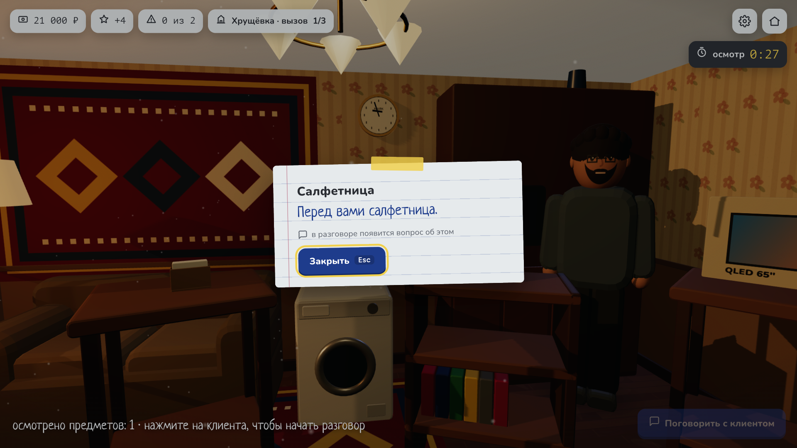
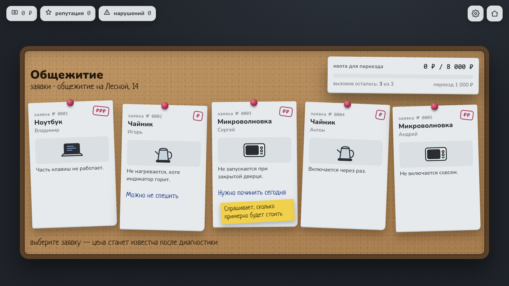
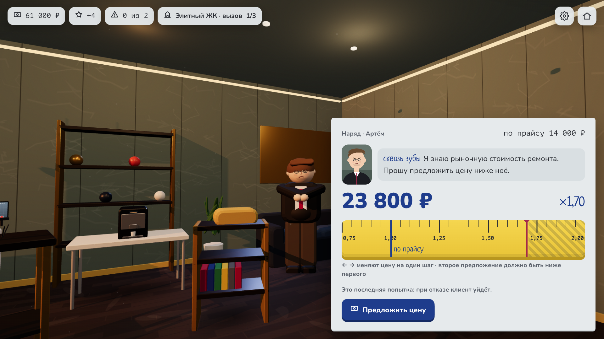
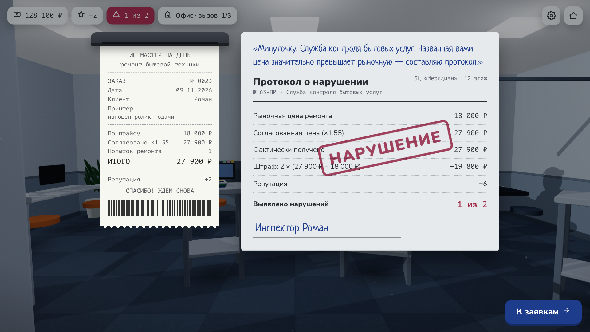
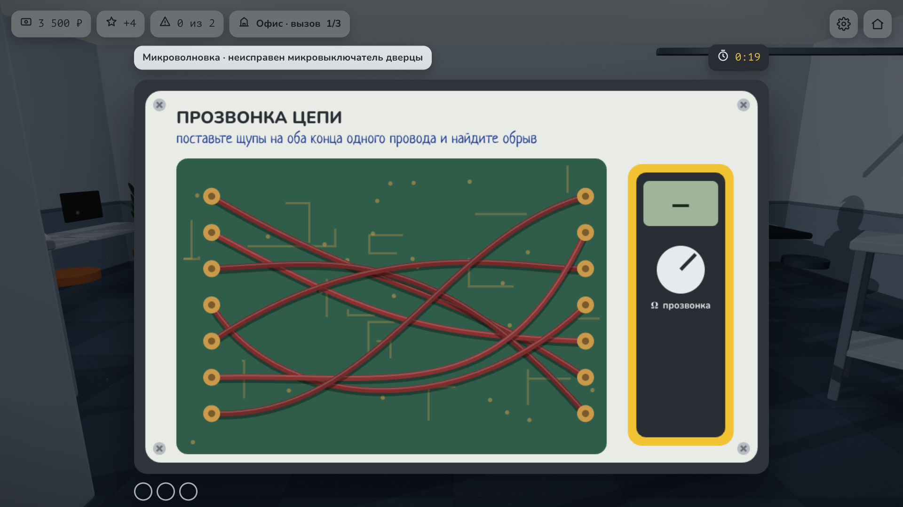

# Мастер на день

Браузерная 3D-игра о выездном мастере: осмотр квартиры, разговор с клиентом, самостоятельное назначение цены ремонта и риск нарваться на проверяющего. Курсовой проект по геймдизайну.



| | |
|---|---|
|  |  |
|  |  |

## Запуск

```bash
cd game
npm install
npm run dev      # http://localhost:5173
npm test         # правила ГДД и симуляция баланса
npm run build    # статическая сборка для itch.io
```

Подробности о коде — в [game/README.md](game/README.md).

## Структура репозитория

| Папка | Что внутри |
|---|---|
| [docs/](docs/) | ГДД в Markdown (удобно открывать как хранилище Obsidian — документы связаны ссылками `[[...]]`, начало — [ГДД Мастер на день](<docs/ГДД Мастер на день.md>)), ревью, журнал правок [Журнал правок ГДД](<docs/Журнал правок ГДД.md>), арт-дирекшн, список ассетов, техплан; [docs/word/](docs/word/) — версии для Word с выделением правок; [docs/_original/](docs/_original/) — исходные тексты из Google Docs |
| [docs/style/](docs/style/) | интерактивная страница утверждения визуального стиля |
| [game/](game/) | игра: TypeScript + Three.js + Vue 3, тесты Vitest и Playwright |
| [tools/](tools/) | симулятор баланса (Python), экспорт Markdown → Word, сравнение версий ГДД, промо-скриншоты |
| [promo/](promo/) | обложка и скриншоты для itch.io, текст страницы |

## Стек

TypeScript, Three.js, Vue 3, Vite, Canvas 2D, Web Audio API, Vitest, Playwright.
